# Okta SAML 2.0 SSO Lab

Hands-on lab: configure Single Sign-On from **Okta (Identity Provider)** to a **SAML 2.0 Service Provider**, map user attributes, assign access, and verify the signed assertion end to end.

| | |
|---|---|
| **Protocol** | SAML 2.0 (Web Browser SSO, IdP-initiated) |
| **Identity Provider** | Okta Integrator Free Plan (Admin Console, 2026.46) |
| **Service Provider** | RSA SAML Test Service Provider (`sptest.iamshowcase.com`) |
| **Time to complete** | ~30 minutes |
| **Difficulty** | Beginner / Intermediate |
| **Cost** | Free |

---

## Table of contents

1. [What you will learn](#what-you-will-learn)
2. [Architecture](#architecture)
3. [Prerequisites](#prerequisites)
4. [Lab values at a glance](#lab-values-at-a-glance)
5. [Walkthrough](#walkthrough)
   - [Step 1: Start a SAML 2.0 app integration](#step-1-start-a-saml-20-app-integration)
   - [Step 2: General settings](#step-2-general-settings)
   - [Step 3: Configure SAML](#step-3-configure-saml)
   - [Step 4: Finish and review the sign-on settings](#step-4-finish-and-review-the-sign-on-settings)
   - [Step 5: Add attribute statements](#step-5-add-attribute-statements)
   - [Step 6: Assign a user](#step-6-assign-a-user)
   - [Step 7: Validate the configuration](#step-7-validate-the-configuration)
   - [Step 8: Test SSO](#step-8-test-sso)
6. [Troubleshooting](#troubleshooting)
7. [Security notes](#security-notes)
8. [Clean up](#clean-up)
9. [Skills demonstrated](#skills-demonstrated)
10. [Extension ideas](#extension-ideas)
11. [References](#references)

---

## What you will learn

- Create a custom **SAML 2.0 app integration** in the Okta Admin Console
- Map the Service Provider's **ACS URL** and **Audience (Entity ID)** into Okta
- Choose a **Name ID format** and application username
- Send user attributes with **attribute statements** (Okta Expression Language)
- Assign an application to a user
- Preview and read a **SAML assertion** (Issuer, Subject, Conditions, AuthnStatement, Attributes)
- Prove a working SSO flow and know where to look when it breaks

## Architecture

IdP-initiated flow used in this lab:

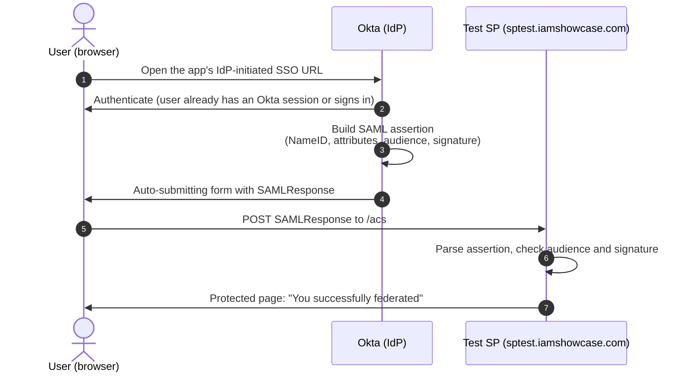

Okta is the source of identity. The SP trusts the assertion Okta signs and never sees the user's Okta password.

## Prerequisites

- An Okta org with Admin Console access. The **Okta Integrator Free Plan** works and is free: <https://developer.okta.com/signup/>
- At least one **active** Okta user to assign (an admin account is fine for a lab)
- A modern browser
- Nothing to install locally

## Lab values at a glance

The Service Provider publishes its own metadata, so you copy two values from it into Okta.

| Okta field | Value used in this lab | Where it comes from |
|---|---|---|
| App name | `Lab - SAML SSO` | Your choice |
| Single sign-on URL (ACS) | `https://sptest.iamshowcase.com/acs` | SP metadata, `AssertionConsumerService Location` |
| Audience URI (SP Entity ID) | `IAMShowcase` | SP metadata, `EntityDescriptor entityID` |
| Name ID format | `EmailAddress` | SP lists it as supported |
| Application username | `Email` | Matches the Name ID format |
| Attribute: `firstName` | `user.profile.firstName` | SP greets the user from `firstName` / `lastName` |
| Attribute: `lastName` | `user.profile.lastName` | |
| Attribute: `email` | `user.profile.email` | |

SP metadata: <https://sptest.iamshowcase.com/testsp_metadata.xml> (see also the [instructions page](https://sptest.iamshowcase.com/instructions)). A copy of these values lives in [`config/saml-settings.md`](config/saml-settings.md).

> **Note:** Many older guides use `samltest.id` as the test SP. That service has been shut down and the domain is now parked, so do not point real assertions at it.

---

## Walkthrough

> Screenshots were taken in the Okta Admin Console, version 2026.46. Account details and org identifiers are redacted.

### Step 1: Start a SAML 2.0 app integration

1. Sign in to the **Admin Console**.
2. Go to **Applications > Applications**.
3. Click **Create App Integration**.

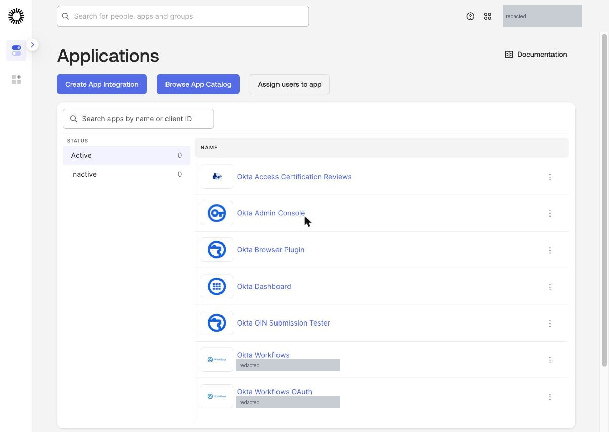

4. Select **SAML 2.0** and click **Next**.

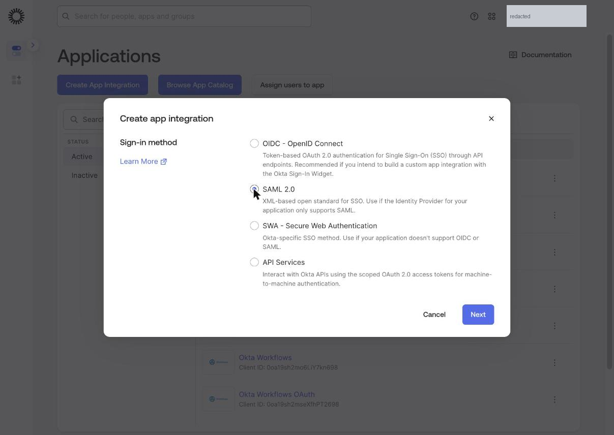

### Step 2: General settings

1. Enter **App name**: `Lab - SAML SSO`.
2. Leave the logo empty and keep the app visible to users.
3. Click **Next**.

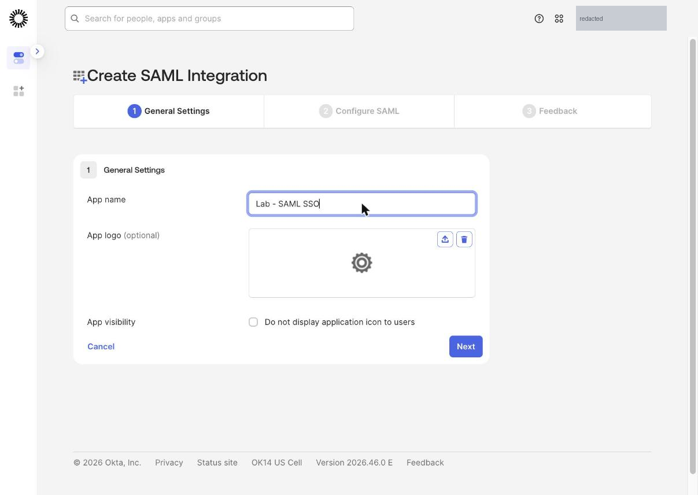

### Step 3: Configure SAML

Fill in the SAML Settings section:

| Field | Value |
|---|---|
| Single sign-on URL | `https://sptest.iamshowcase.com/acs` |
| Use this for Recipient URL and Destination URL | Checked |
| Audience URI (SP Entity ID) | `IAMShowcase` |
| Default RelayState | *(empty)* |
| Name ID format | `EmailAddress` |
| Application username | `Email` |
| Update application username on | `Create and update` |

Leave **Advanced Settings** at their defaults. By default Okta signs both the response and the assertion with RSA-SHA256, which this SP requires (`WantAssertionsSigned="true"`).

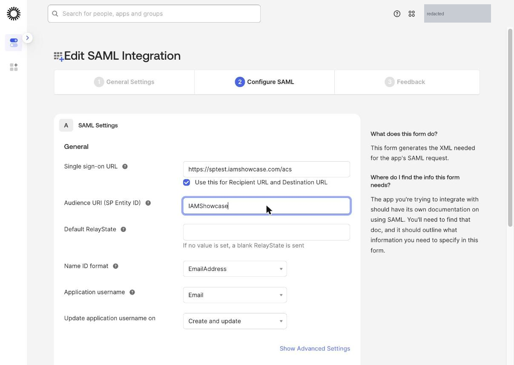

> The screenshot title reads "Edit SAML Integration" because the values were captured when re-opening the wizard. The form is identical during creation.

Click **Next**.

### Step 4: Finish and review the sign-on settings

1. On the Feedback step, tick **This is an internal app that we have created**.
2. Click **Finish**.

Okta opens the app on the **Sign On** tab. Note the **Metadata URL**. It is the IdP metadata you would hand to a Service Provider that wants to import Okta's signing certificate and endpoints. This particular test SP does not need it for IdP-initiated SSO.

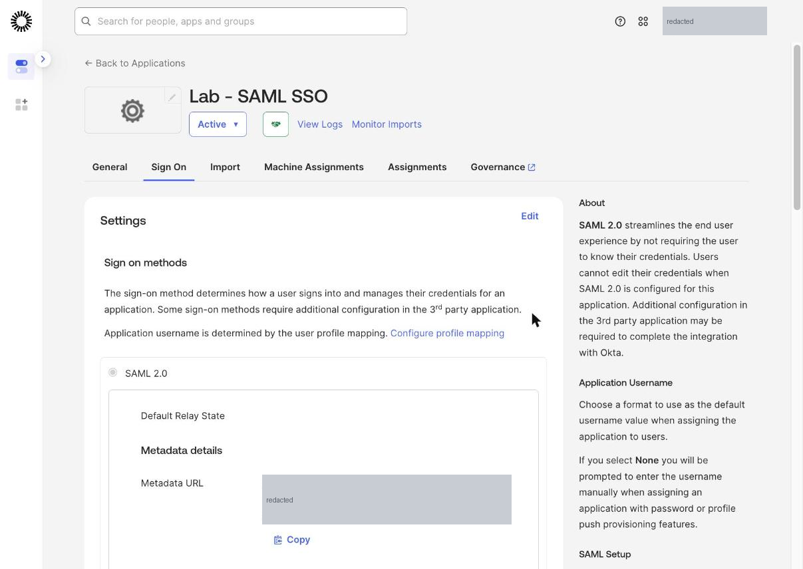

### Step 5: Add attribute statements

Attribute statements send profile data to the SP inside the assertion.

1. On the **Sign On** tab, scroll to **Attribute statements**.
2. Click **Add expression** and add three rows:

| Name | Expression |
|---|---|
| `email` | `user.profile.email` |
| `firstName` | `user.profile.firstName` |
| `lastName` | `user.profile.lastName` |

> In this Admin Console version the editor rejects `user.email` with *"Invalid property email in expression user.email"*. Use the `user.profile.<attribute>` form.

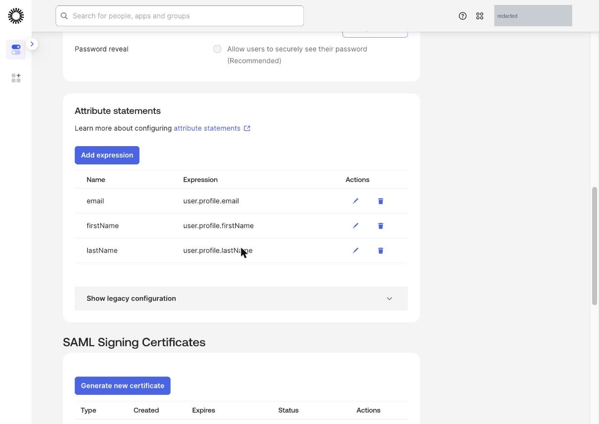

### Step 6: Assign a user

An app only works for users or groups assigned to it.

1. Open the **Assignments** tab.
2. Click **Assign > Assign to People**.
3. Click **Assign** next to the user, confirm the username, and choose **Save and Go Back**, then **Done**.

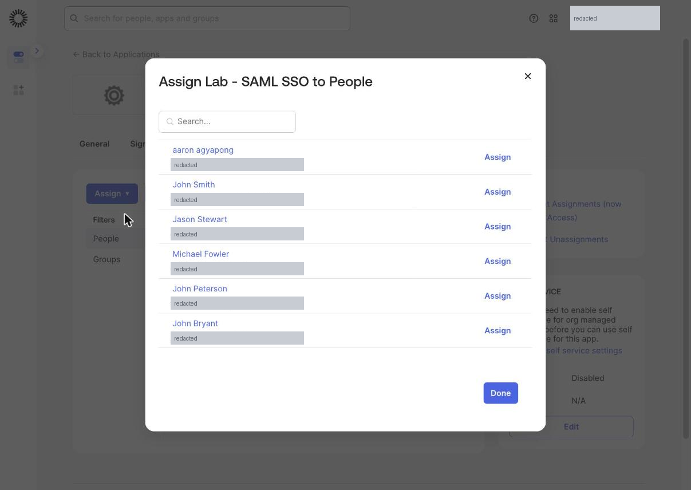

The user now appears in the assignment list.

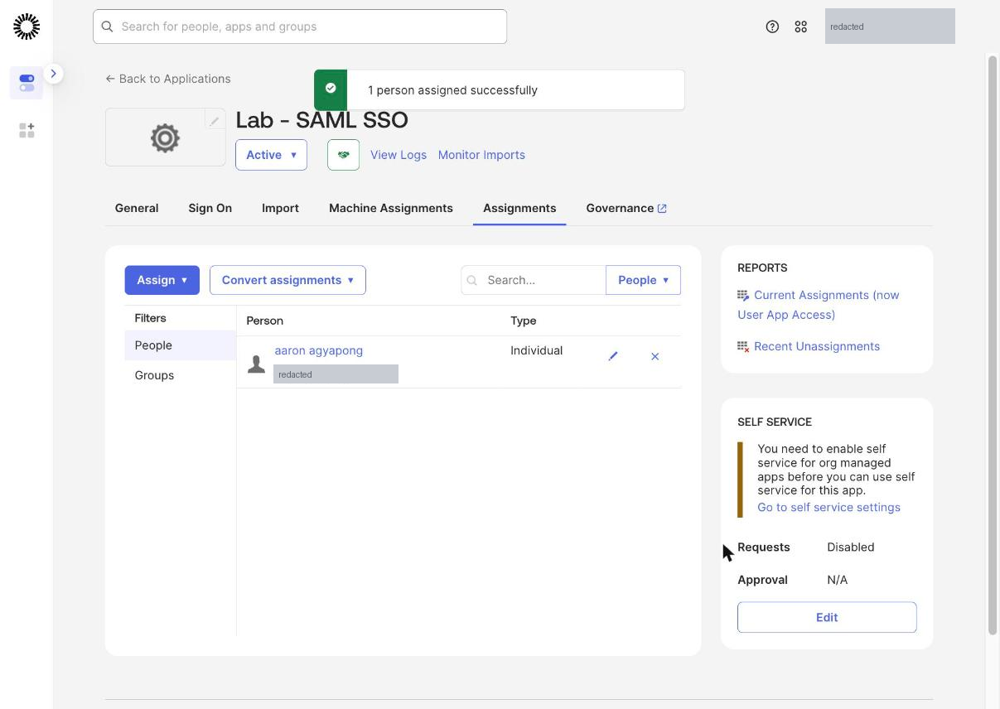

### Step 7: Validate the configuration

**Review the saved settings.** On the **General** tab, the **SAML Settings** panel summarises what Okta will send: ACS, Recipient, Destination, Audience, Name ID format, and signing algorithms.

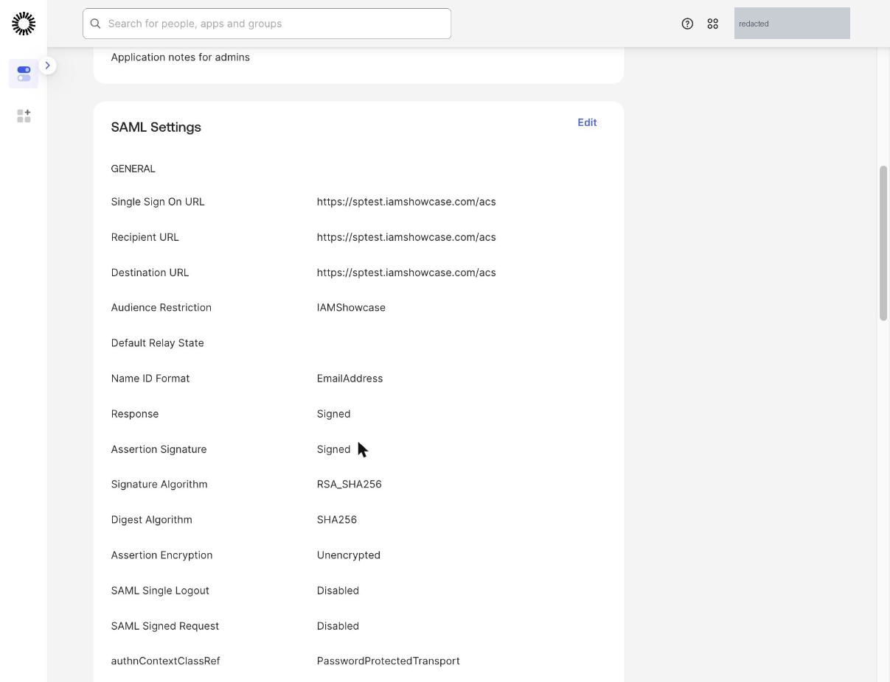

**Preview the assertion.** On the **General** tab choose **SAML Settings > Edit > Next**, then click **Preview the SAML Assertion**. Okta renders the exact XML it will send. Check these elements:

| Element | Expected |
|---|---|
| `Issuer` | `http://www.okta.com/<app-key>` |
| `NameID Format` | `...nameid-format:emailAddress` |
| `SubjectConfirmationData Recipient` | `https://sptest.iamshowcase.com/acs` |
| `Audience` | `IAMShowcase` |
| `AuthnContextClassRef` | `...PasswordProtectedTransport` |
| `Attribute` names | `firstName`, `lastName`, `email` |

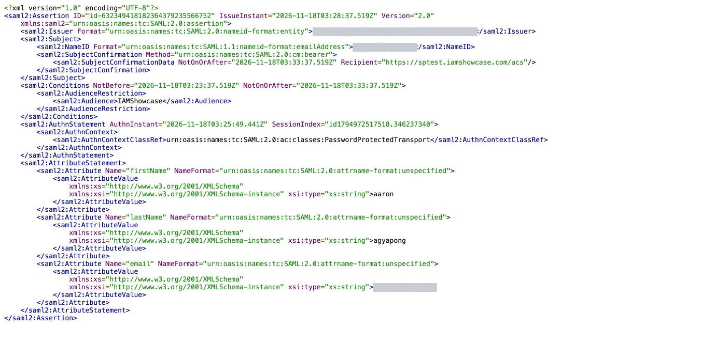

Cancel out of the wizard when done. Nothing changes.

### Step 8: Test SSO

1. While signed in to Okta as the assigned user, open the app's IdP-initiated SSO URL:

   ```
   https://<your-org>.okta.com/app/<app-name>/<app-key>/sso/saml
   ```

   Okta posts the signed assertion to the SP's ACS endpoint.

2. The Service Provider displays the protected page and greets you by name. That greeting comes from the `firstName` and `lastName` attributes.

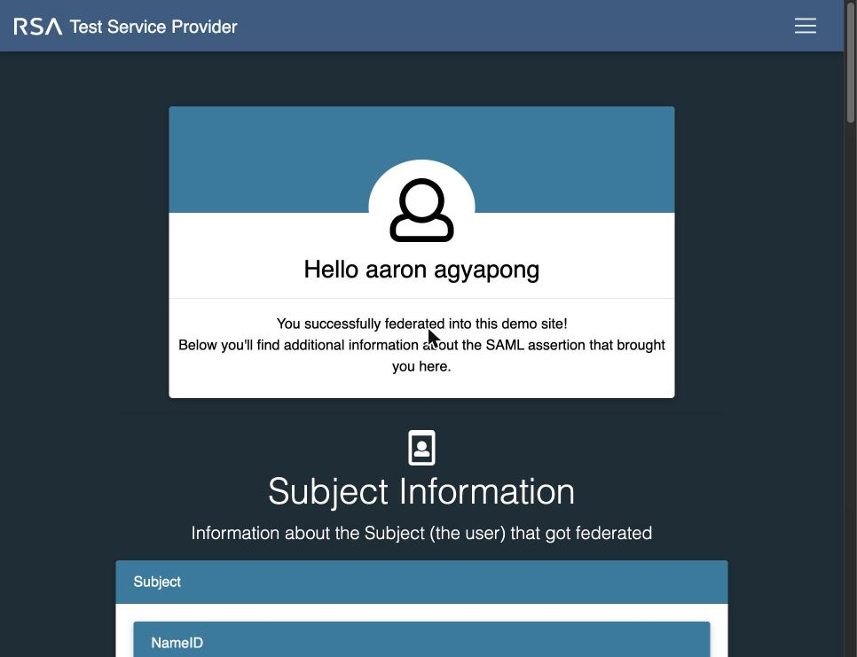

3. Scroll down to inspect what the SP received.

**Subject.** The NameID matches the Okta email and uses the `emailAddress` format.

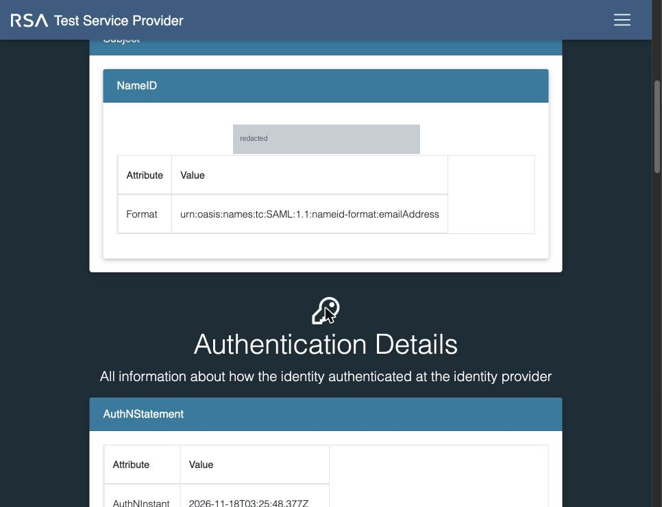

**Attributes.** `firstName`, `lastName` and `email` arrive exactly as mapped in Step 5.

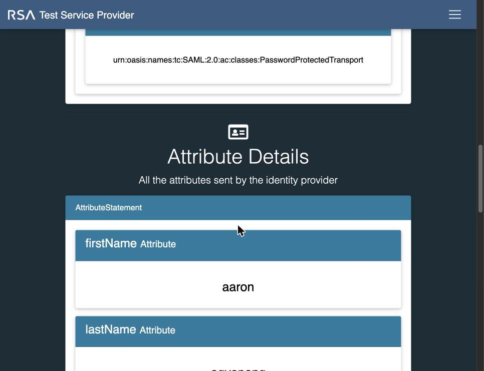

The SP's assertion details also report `StatusCode: Success`, the Okta issuer, a 10-minute validity window (`NotBefore` to `NotOnOrAfter`), `SHA256` hashing, and the `IAMShowcase` audience restriction.

**Result: SSO works end to end.** The Okta app also appears in the Applications list:

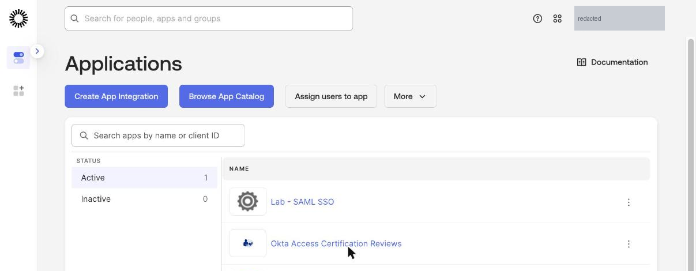

---

## Troubleshooting

| Symptom | Likely cause | Fix |
|---|---|---|
| `Invalid property ... in expression user.email` | The attribute editor needs the profile path | Use `user.profile.email`, `user.profile.firstName`, and so on |
| SP shows an audience or entity error | **Audience URI** in Okta does not match the SP's entity ID exactly | Copy `entityID` from the SP metadata (`IAMShowcase`), no trailing slash |
| SP rejects the response or reports a destination mismatch | Wrong ACS URL | Use the `AssertionConsumerService Location` from SP metadata |
| SP says the assertion is not signed | Signing options changed | Keep **Response** and **Assertion Signature** at `Signed` in Advanced Settings |
| "User is not assigned to this application" | No assignment | Complete [Step 6](#step-6-assign-a-user) |
| Greeting shows the email instead of a name | Attribute names do not match what the SP looks for | Name them `firstName` / `lastName` (the SP matches case-insensitively) |
| Okta keeps asking for MFA or a passkey | Authentication policy requires step-up | Complete the prompt. It is a policy decision, not a SAML fault |
| Test SP unreachable or showing ads | The service has been retired or the domain changed hands | Confirm the site is live and trusted before pointing assertions at it. `samltest.id` is an example of a retired test SP |

Useful tools when debugging: the **Preview the SAML Assertion** button, the Okta **System Log** (Reports > System Log, filter on the app), and a SAML tracer browser extension.

## Security notes

- The RSA test SP **trusts every IdP** and displays whatever it receives. It is for demos only. Do not send real employee or customer data to it. Use a lab user.
- SAML assertions contain personal data (name, email). Redact screenshots before publishing. The images in this repository have emails, org identifiers and the app-specific IdP key removed.
- This lab uses no client secrets or API tokens. If you extend it to OIDC, never commit client secrets.
- Never leave an app configured to send assertions to a domain you do not control. Remove or deactivate lab apps when finished.

## Clean up

1. **Applications > Applications > Lab - SAML SSO > Assignments**: remove the user (the `x` icon).
2. Open the app's **Status** menu (top of the app page) and choose **Deactivate**.
3. On the Inactive apps list, choose **Delete** for `Lab - SAML SSO`.

The test SP keeps no registration for IdP-initiated SSO, so nothing needs removing on its side.

## Skills demonstrated

- SAML 2.0 SSO configuration (IdP side) and SP metadata interpretation
- Name ID formats, audience restriction, ACS/Recipient/Destination validation
- Attribute mapping with Okta Expression Language
- Application assignment and access control
- Assertion analysis and end-to-end SSO verification
- Troubleshooting and secure documentation (redaction, no secrets)

## Extension ideas

- **Group-based assignment:** assign the app to an Okta group and add a **group attribute statement**
- **SP-initiated SSO:** upload Okta's IdP metadata to the test SP and sign in from the SP's unique login URL
- **App sign-on policy:** require MFA for the app and observe the step-up in the assertion's `AuthnContext`
- **Single Logout (SLO):** enable it and test session termination
- **Automate with PowerShell or the Okta API:** create the app, assign users and read the System Log programmatically
- **OIDC version of this lab:** compare ID token claims to SAML attributes

## References

- Okta: [Create SAML app integrations](https://help.okta.com/oie/en-us/content/topics/apps/apps_app_integration_wizard_saml.htm)
- Okta: [Okta Expression Language](https://developer.okta.com/docs/reference/okta-expression-language/)
- RSA SAML Test Service Provider: <https://sptest.iamshowcase.com/>
- OASIS: [SAML 2.0 Technical Overview](https://docs.oasis-open.org/security/saml/Post2.0/sstc-saml-tech-overview-2.0.html)

---

*Lab built and verified on 2026-11-17.*
